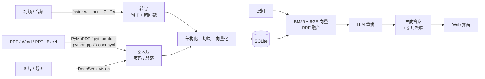

# 把视频和文档变成能问答的知识库


这是我实习期间做的一个项目。

起因很具体：老板手里有一堆课程视频、PDF、Word、PPT，还有微信群里的截图。他想找某个观点，只能拖进度条一个个翻；想确认一句话是谁说的，得从头看。我做了个系统，把这些东西统一变成能搜、能问的知识库，答案是带出处的——点一下就能跳回原视频的那一分钟，或者 PDF 的那一页。

---

## 它现在能做什么

- 支持 **7 种格式**：视频、音频、PDF、Word、PPT、Excel、图片；
- 上传后自动转写/解析/结构化，几十秒到几分钟变成「可用」；
- 用大白话提问，答案给结论 + 要点，每句话后面有 `[n]` 引用；
- 点引用能跳回原文：视频跳秒、PDF 跳页、Word 显示段落、图片打开原图；
- 资料里没有的东西，它会直接说「没有提到」，不编。

## 效果

我自己标了 75 道题测的（视频、文档、图片都有）：

| 指标 | 结果 |
|---|---|
| 正确答案在召回前 5 的比例 | **0.88** |
| 正确出处排第一的频次（MRR） | 0.70 |
| 答案引到正确出处的比例 | **0.81** |
| 超纲问题拒答率 | **100%**（10/10） |
| 回答耗时 中位 / P95 | 4.5s / 6.3s |
| 视频转写速度 | 约 24 倍实时（RTX 4060） |

> 题是模型先出、我人工删改过的；评测脚本在 [`eval/`](eval/)，方法和完整数据在 [`docs/评测报告.md`](docs/评测报告.md)。

## 怎么做的



一句话：**接入 → 理解 → 检索 → 生成**。每一步都能单独替换，比如转写可以换云 ASR，向量可以换模型，不影响其他层。

## 几个我自己做的决定

**用 SQLite，没用 Postgres。**
单用户、单机、数据 100 MB 级别，SQLite 零运维、整个库就是一个文件，备份就是复制。上 PG 只有在多用户或并发写时才划算。

**没上向量数据库。**
全库 1000 个块，numpy 暴力算余弦只要 20ms。装 Milvus 只会多一个部署和故障点。我给自己定的线是：10 万块以上再考虑 ANN。

**转写放本地，没用云 ASR。**
数据不出内网，转写不花钱。代价是要有张显卡——没有的话云 ASR 是更好的选择，2 小时视频大概 1.6 元。

**检索用 BM25 + 向量，不是只用向量。**
关键词能补语义召回的漏，语义能补换个说法就搜不到的问题。融合用 RRF，因为它只看排名、不看分数量纲，两路分数没法直接比。

**答案要校验引用。**
模型有时会把引用挂到不相关的片段上。我加了一步：答案里引用了 `[n]` 的那句话，和被引片段字面重合度太低，就标成「弱引用」，提醒用户核对。

## 跑起来

Windows + Python 3.10。有 NVIDIA 显卡会自动用 GPU 转写，没有就走 CPU。

```bash
git clone https://github.com/wwf521xxl/-KnowRAG-Sage-.git
cd -KnowRAG-Sage-

python -m venv .venv
.venv\Scripts\activate
pip install -r requirements.txt

python fetch_model.py              # 转写模型，约 1.5 GB
python fetch_embedding_model.py    # 向量模型，约 24 MB

copy config.example.json config.local.json   # 填自己的 DeepSeek API Key
python set_password.py 你的密码 boss

python batch.py scan "D:\你的资料目录"
python batch.py run

python kb_server.py 8010
```

打开 `http://127.0.0.1:8010` 就能用。

> 想让它开机自启、常驻托盘：双击 `start_all.bat`，或者跑 `install_autostart.ps1`。

## 踩过的坑

**1. 切块跨了文档。**
一开始把连续句子拼成 500 字的块，没注意文档边界：上一份文档的尾巴和下一份的开头被拼在一起，块的归属记错了。表现是「图片里的内容搜不到」。修法是换文档时强制清空缓冲。

**2. 每次提问都在重建索引。**
第一版评测时 P95 是 8.3 秒。看耗时明细才发现，每次提问都会写一条问答日志，数据库文件 mtime 变了，索引缓存就失效，于是 2.7 万段全部重读。改成按内容指纹判断重建后，P95 降到 6.3 秒。

**3. 评测的尺子错了两次。**
一次是视频匹配只允许 90 秒偏差，但一个块覆盖 2–3 分钟，答案明明在块里却判成没召回；一次是 Word 的「第 N 段」按字符串比对，块起点不是 N 就判错。修完这两次，Recall 从 0.79 涨到 0.85——**但这不是系统变好了，是我量错了。**

**4. CI 第一次就红了。**
不是测试失败，是测试还没跑起来就 `ImportError`：`batch.py` 顶层 `import av`，CI 只装了最小依赖。改成函数内懒加载就绿了，顺带让模块在不用视频功能时更轻。

## 目录

```
├─ kb_server.py        # 服务：检索、问答、上传、鉴权
├─ batch.py            # 导入流水线：扫描、转写、解析、结构化
├─ asr_runtime.py      # CUDA + faster-whisper 封装
├─ embeddings.py       # BGE 向量
├─ watch.py            # 收件箱监听
├─ backup.py / healthcheck.py / report.py / weekly_report.py
├─ app.py              # 托盘控制面板
├─ kb.html             # 单页前端
├─ eval/               # 评测：出题、跑分、门禁
├─ scripts/            # 一次性调试/迁移脚本
└─ docs/               # 方案、手册、报告
```

## 没做好的地方

- **单用户**：一个库、一个账号，没有多租户和权限；
- **只在 Windows 上验证过**：启动脚本、CUDA DLL、托盘都是 Windows 方案；
- **评测集只有 75 条**：噪声大约 ±0.03，小改动很难验证，后面要扩到 150 条并留 holdout；
- **扫描版 PDF 不支持**：没有文字层就提取不到，需要 OCR；
- **并发**：单进程 + 线程，几个人同时问会排队。

## 文档

- [评测报告](docs/评测报告.md)：怎么出题、指标定义、六次实验记录
- [3 分钟演示脚本](docs/DEMO.md)：给面试现场用的
- [迁移操作手册](docs/迁移操作手册.md)：换机器怎么部署
- [老板使用说明](docs/老板使用说明.md)：最终用户手册
