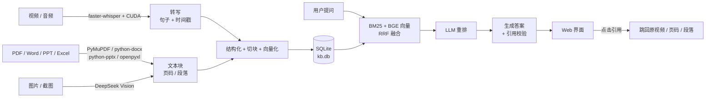

# 多模态知识库问答系统


把视频、音频、PDF、Word、PPT、Excel、图片统一变成**可检索、可问答、带出处引用**的知识库。
面向真实场景：用户自己上传资料，自己提问，答案可以点回原文的时间戳或页码。

**[效果](#效果) · [架构](#架构) · [快速开始](#快速开始) · [设计取舍](#三个关键取舍) · [评测](#评测)**

---

## 效果

在 75 条人工审核的问题上（覆盖 7 种格式）：

| 指标 | 结果 |
|---|---|
| Recall@5（正确出处在召回前 5） | **0.88** |
| MRR | **0.70** |
| 引用召回（答案引到正确出处） | **0.81** |
| 超纲问题拒答率 | **100%**（10/10） |
| 端到端延迟 中位 / P95 | **4.5s / 6.3s** |
| 视频转写速度 | **约 24 倍实时**（RTX 4060） |

> 评测方法与复现命令见 [`eval/README.md`](eval/README.md)，完整报告见 [`评测报告.md`](docs/评测报告.md)。

---

## 架构



四层：**接入（7 种格式）→ 理解（转写/解析/结构化）→ 检索（混合召回）→ 生成（带引用）**。

---

## 快速开始

环境：Windows 10/11、Python 3.10；有 NVIDIA 显卡时自动用 GPU 转写，没有则回退 CPU。

```bash
git clone https://github.com/WWF521XXL/<repo>.git
cd <repo>

python -m venv .venv
.venv\Scripts\activate
pip install -r requirements.txt

# 下载模型（首次）
python fetch_model.py              # 转写模型 ~1.5 GB
python fetch_embedding_model.py    # 向量模型 ~24 MB

# 配置：复制模板，填入自己的 DeepSeek API Key
copy config.example.json config.local.json
python set_password.py 你的密码 boss

# 导入资料并处理
python batch.py scan "D:\你的资料目录"
python batch.py run

# 启动
python kb_server.py 8010
```

打开 `http://127.0.0.1:8010`，用设置的账号登录。

> 想开机自启、托盘常驻：双击 `start_all.bat`，或运行 `install_autostart.ps1`。

---

## 三个关键取舍

**1. 为什么用 SQLite 而不是 PostgreSQL？**
单用户、单机、数据量 100 MB 级别；SQLite 零运维、可整库拷走、备份就是复制文件。
上 PG 只有在多用户或需要并发写时才划算。

**2. 为什么不用向量数据库？**
全库 1000 个块，numpy 暴力算余弦只需 **20 ms**。
引入 Milvus/Chroma 会增加部署和故障点，收益为零。规模到 10 万块以上再换 ANN。

**3. 为什么转写放本地而不是云 ASR？**
数据不出内网、零边际成本；代价是需要一张显卡。
对比：云 ASR 约 0.8 元/小时，2 小时视频约 1.6 元，但没有显卡时是唯一解。

**另外两个设计选择**：

- **BM25 + 向量融合**：关键词补语义漏召回，语义补同义表述；用 RRF 是因为两路分数量纲不可比。
- **引用校验**：答案句子与被引片段字面重合度过低时标为「弱引用」，防止引用挂错。

---

## 评测

```bash
# 出题（LLM 生成候选，人工审核）
python eval/build_candidates.py
python eval/review_server.py        # http://127.0.0.1:8020

# 跑分 + 回归门禁
python eval/run_eval.py --file eval/golden.jsonl --save-baseline
python eval/run_eval.py --file eval/golden.jsonl --check

# 拒答专项
python eval/check_refusal.py
```

指标：Recall@5、MRR、引用召回、平均引用数、拒答准确率、P95 延迟。

> 评测过程中修过三次「尺子」：时间容差、Word 段号匹配、负样本有效性。
> 教训是：**先确认失败是真的，再优化系统。**

---

## 目录结构

```
├─ kb_server.py          # HTTP 服务：检索、问答、上传、鉴权
├─ kb.html               # 单页前端
├─ kb.db 相关
│  ├─ batch.py           # 导入流水线：扫描/转写/解析/结构化
│  ├─ asr_runtime.py     # CUDA DLL + faster-whisper 封装
│  └─ embeddings.py      # BGE ONNX 向量
├─ watch.py              # 收件箱监听 + 定时备份
├─ backup.py / healthcheck.py / weekly_report.py   # 运维
├─ app.py                # 托盘控制面板
├─ eval/                 # 评测：出题、跑分、门禁
├─ scripts/              # 一次性调试/迁移脚本（42 个），保留以便复现
└─ docs/archive/         # 历史方案（已归档，不影响主流程）
```

> 根目录的一次性脚本较多（probe_*.py、debug_*.py），是迭代过程的记录，不影响主流程。

---

## 技术栈

| 层 | 选型 |
|---|---|
| 后端 | Python 3.10、`http.server`（无 Web 框架） |
| 前端 | 原生 HTML/CSS/JS（单文件） |
| 转写 | faster-whisper 1.1.1 + CTranslate2 + CUDA |
| 解析 | PyMuPDF、python-docx、python-pptx、openpyxl、Pillow |
| 向量 | BGE-small-zh-v1.5（ONNX 量化，CPU） |
| 检索 | 字符 bigram BM25 + 余弦 + RRF + LLM 重排 |
| 生成 | DeepSeek API（OpenAI 兼容） |
| 存储 | SQLite + 本地文件 |
| 鉴权 | HMAC 签名 Cookie + PBKDF2-SHA256 |

---

## 已知限制

- **单用户**：一个库、一个账号，没有多租户和权限体系；
- **Windows 优先**：启动脚本、CUDA DLL、托盘都是 Windows 方案；
- **评测规模**：75 条题，噪声约 ±0.03，小改动难以验证；
- **扫描版 PDF** 需要 OCR，当前不支持；
- **并发**：单进程 + 线程，多路同时提问会排队。

---

## 文档

- [`评测报告.md`](docs/评测报告.md)：方法、指标、实验记录
- [`DEMO.md`](docs/DEMO.md)：3 分钟演示脚本与话术
- [`迁移操作手册.md`](docs/迁移操作手册.md)：换机器部署
- [`老板使用说明.md`](docs/老板使用说明.md)：最终用户手册
- [`面试准备清单.md`](docs/面试准备清单.md)：项目讲述与高频追问


