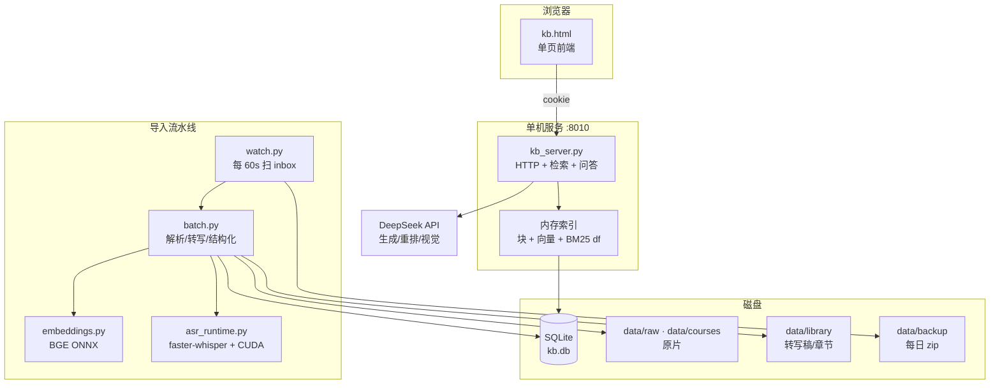
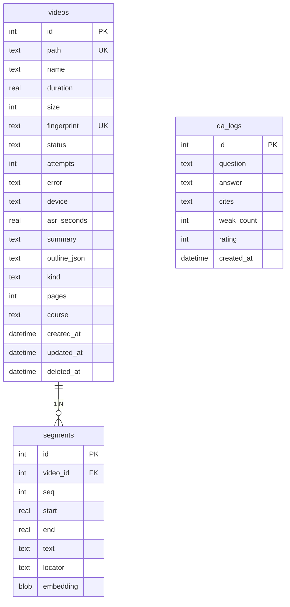
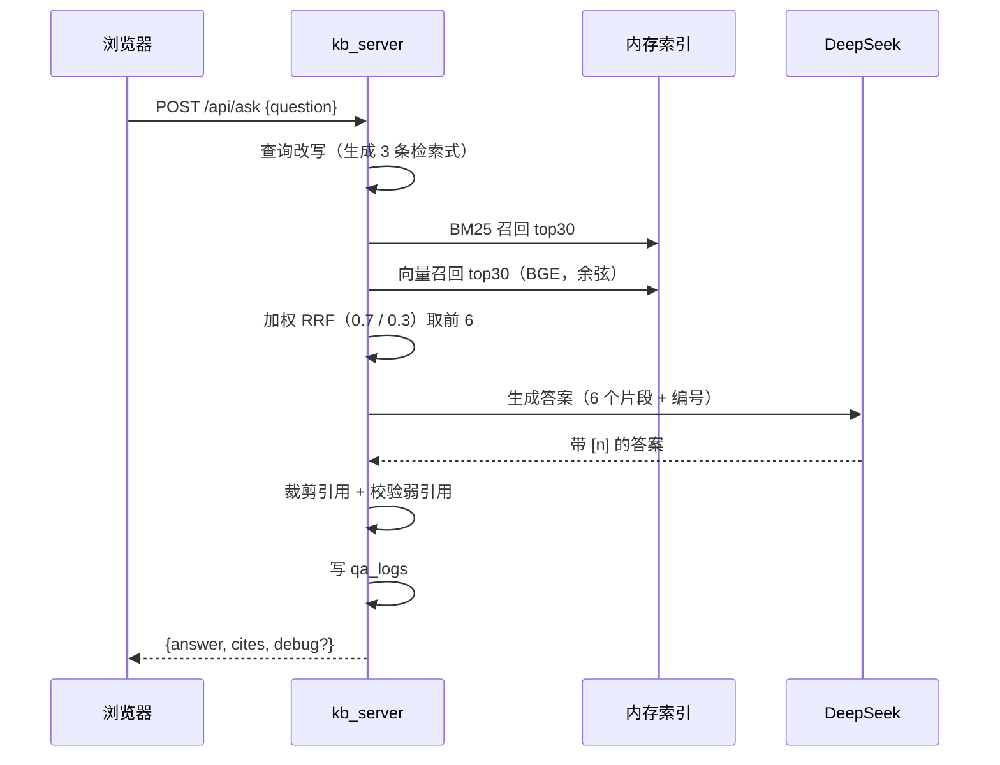
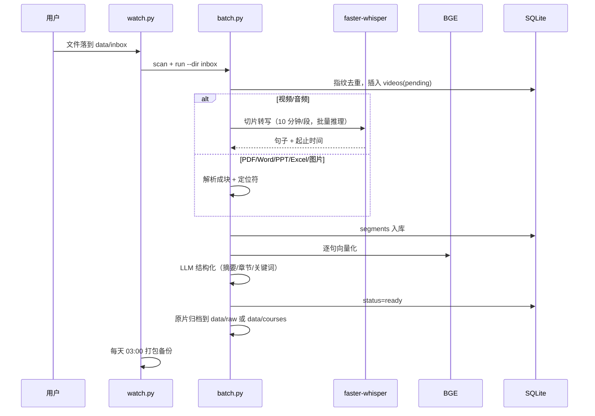

# 系统设计说明

> 给接手的人（或面试官）看的：数据怎么存、接口长什么样、一次问答经过哪些步骤、坏了怎么排查。

---

## 1. 组件



**单进程、单机**。没有消息队列、没有 Redis、没有反向代理。数据量在 10 万块以内时，这个结构够用且故障点最少。

---

## 2. 数据模型



| 表 | 作用 | 关键点 |
|---|---|---|
| `videos` | 一条内容 = 一个视频/文档/图片 | `status` 驱动流水线；`deleted_at` 是软删除；`course` 用于分组 |
| `segments` | 切句后的最小检索单元 | 视频带 `start/end`，文档带 `locator`（`p12`/`第3段`/`第1张`）；`embedding` 存 float32 blob |
| `qa_logs` | 问答记录 + 反馈 | `weak_count` 记录弱引用数，`rating` 是 👍/👎 |

**为什么向量存在 segments 而不是 chunk？** 切块规则可能调整（500 字 → 350 字），存在更细的句子上就不用重算向量；检索时按块取平均再归一化。

---

## 3. 接口

除 `/login`、`/api/login` 外，所有 `/api/*` 都要求 `kb_session` Cookie（HMAC 签名，7 天）。

### 读

| 方法 | 路径 | 说明 |
|---|---|---|
| GET | `/` | 主页面（未登录 302 到 `/login`） |
| GET | `/api/videos` | 内容列表（带 course、state、missing、error） |
| GET | `/api/progress` | 各状态数量与时长 |
| GET | `/api/trash` | 回收站 |
| GET | `/api/stats` | 看板：提问量、有用率、弱引用、Top 问题 |
| GET | `/api/health` | 存活探针（条数 / 块数） |
| GET | `/cover?course=` | 课程封面（首帧或占位图，按课程名缓存） |
| GET | `/video/{id}` `·` `/file/{id}` | 原文件流，支持 Range（拖动进度条） |

### 写

| 方法 | 路径 | 参数 | 说明 |
|---|---|---|---|
| POST | `/api/login` | `{username, password}` | 成功返回 Set-Cookie |
| POST | `/api/logout` | — | 清 Cookie |
| POST | `/api/ask` | `{question, course?, debug?, mode?}` | 问答；`mode` 用于消融（bm25/vector/hybrid/hybrid_rerank） |
| POST | `/api/upload` | `?name=&course=`，body 为原始字节 | 小文件直传 |
| POST | `/api/upload_chunk` | `?upload_id=&index=` | 分片上传，4 MB/片 |
| POST | `/api/upload_finish` | `?upload_id=&name=&total=&course=` | 合并分片，落到 inbox |
| POST | `/api/feedback` | `{id, rating}` | 👍=1 / 👎=-1 |
| POST | `/api/retry/{id}` | — | 失败任务重新入队 |
| POST | `/api/delete/{id}` | — | 软删除 |
| POST | `/api/restore/{id}` | — | 从回收站恢复 |
| POST | `/api/purge/{id}` | — | 彻底删除（含文件） |

### 返回结构（`/api/ask`）

```json
{
  "answer": "…… [1][2]",
  "cites": [{"n":1,"video_id":15,"locator":"10:35","time":"10:35","kind":"video",
             "page":null,"snippet":"…","weak":false}],
  "used": 6,
  "log_id": 1615,
  "debug": {"retrieved":[{"rank":1,"locator":"10:35","bm25":21.7,"vec":0.59,"fused":0.029}],
            "timings":{"load_ms":9,"bm25_ms":631,"vec_ms":21,"rerank_ms":0,"answer_ms":1632,
                       "total_ms":3941},
            "refused": false}
}
```

`debug` 只在传 `debug:true` 时返回，用于评测与排查。

---

## 4. 一次问答的时序



要点：

- 索引在内存里，只在 `videos/segments` 内容变化时重建（按内容指纹，不按文件 mtime）；
- 重排默认关闭——消融实验显示它在当前语料上是负收益（见 README）；
- 引用校验用"答案句子 ∩ 被引块"的字符重合度，低于阈值标 `weak`。

## 5. 一次导入的时序



---

## 6. 部署拓扑

```
办公室局域网
├─ 服务机（Windows，D:\知识库问答系统）
│   ├─ :8010  知识库服务（对老板开放）
│   ├─ :8011  收件箱监听（仅本机，单实例锁）
│   └─ data/  库、原片、备份
└─ 老板电脑 / 手机
    └─ 浏览器 → http://<服务机IP>:8010
```

可选：`data/inbox` 通过 SMB 共享（`\\<IP>\KB-Inbox`），老板直接拖文件。

---

## 7. 故障模式与处理

| 故障 | 表现 | 处理 |
|---|---|---|
| DeepSeek 超时/欠费 | 问答返回 500 或慢 | 检查 Key 与余额；导入不受影响 |
| 原片被移动/删除 | 列表标「源文件缺失」，点开 404 | 恢复文件后跑 `fix_paths.py`；问答仍可用（文字在库） |
| 扫描版 PDF | 提示"未提取到文字，需要 OCR" | 换文字版，或后续接 OCR |
| 端口被占 | 服务起不来 | `netstat -ano | findstr :8010` 找到 PID 结束 |
| 起了两个服务 | 时好时坏、偶尔答旧内容 | 只保留一种自启方式（启动文件夹或计划任务） |
| 上传中断 | inbox 里出现残缺文件 | 分片上传会重试；失败的文件删掉重传 |
| 数据库被占用 | 写入报 `database is locked` | 确认没有第二个进程在跑；备份用 SQLite backup API |
| 磁盘满 | 导入失败、备份失败 | `healthcheck.py` 会提示剩余空间 |

---

## 8. 扩展点

| 想换什么 | 改哪里 | 说明 |
|---|---|---|
| 向量模型 | `embeddings.py` | 换模型后需重算全部 `segments.embedding` |
| 云 ASR | `asr_runtime.py` 增加后端 | 接口不变：返回句子 + 起止时间 |
| 重排模型 | `ask()` 的 `hybrid_rerank` 分支 | 现在是 LLM 重排，可换 cross-encoder ONNX |
| 向量数据库 | `load_index` / `bm25` / 向量召回 | 10 万块以上再考虑 ANN |
| 多用户 | `videos` 加 `owner_id`，`qa_logs` 同理 | 鉴权改成会话表 + 角色 |
| 对象存储 | `videos.path` 改 `s3://`，`/file` 转发 Range | 原片托管到 MinIO/S3 |

---

## 9. 已知边界

- **单写者**：SQLite + 单进程，两台机器不能同时写同一个库；
- **无队列**：导入是串行批处理，大视频会占住 GPU；
- **索引在内存**：10 万块以上要考虑分片或 ANN；
- **评测 75 题**：噪声约 ±0.03，小改动难验证。
